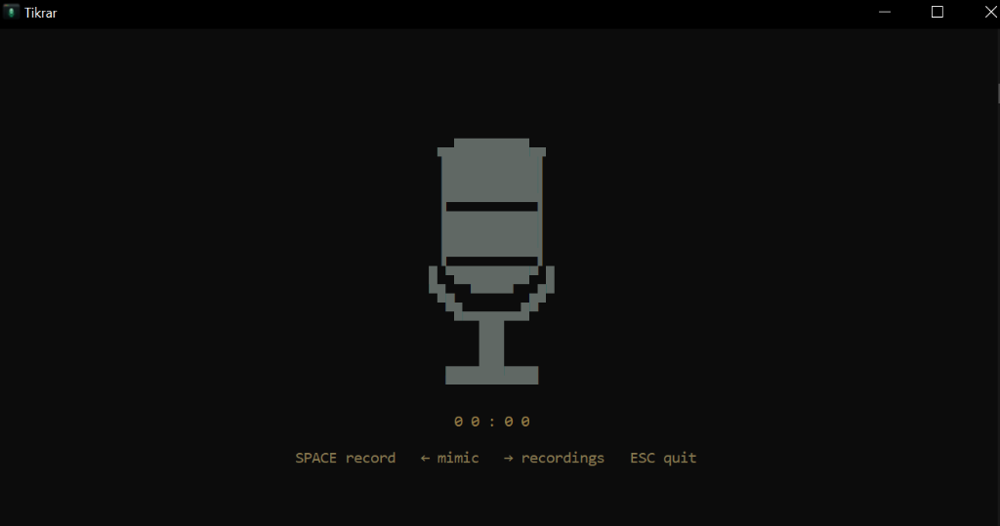

  

<h1 align="center">Tikrar</h1>

  A terminal-based audio recording &amp; Quran recitation studio for Windows.

  
  
  

---

## Features

- 🎙️ High-quality voice recording (MP3, 128 kbps)
- 📖 Built-in Quran player with verse-by-verse recitation
- 🎵 Mimic mode - listen and record along with reciters
- 🎨 Retro terminal UI with multiple visual styles
- ⌨️ Fully keyboard-driven - no mouse needed
- 📁 Organized recordings folder

## Install

1. Download **Tikrar.zip** from [Releases](../../releases/latest).
2. Extract anywhere.
3. Run **Tikrar.exe**.

## Screenshot

  

## License

[MIT](LICENSE)
